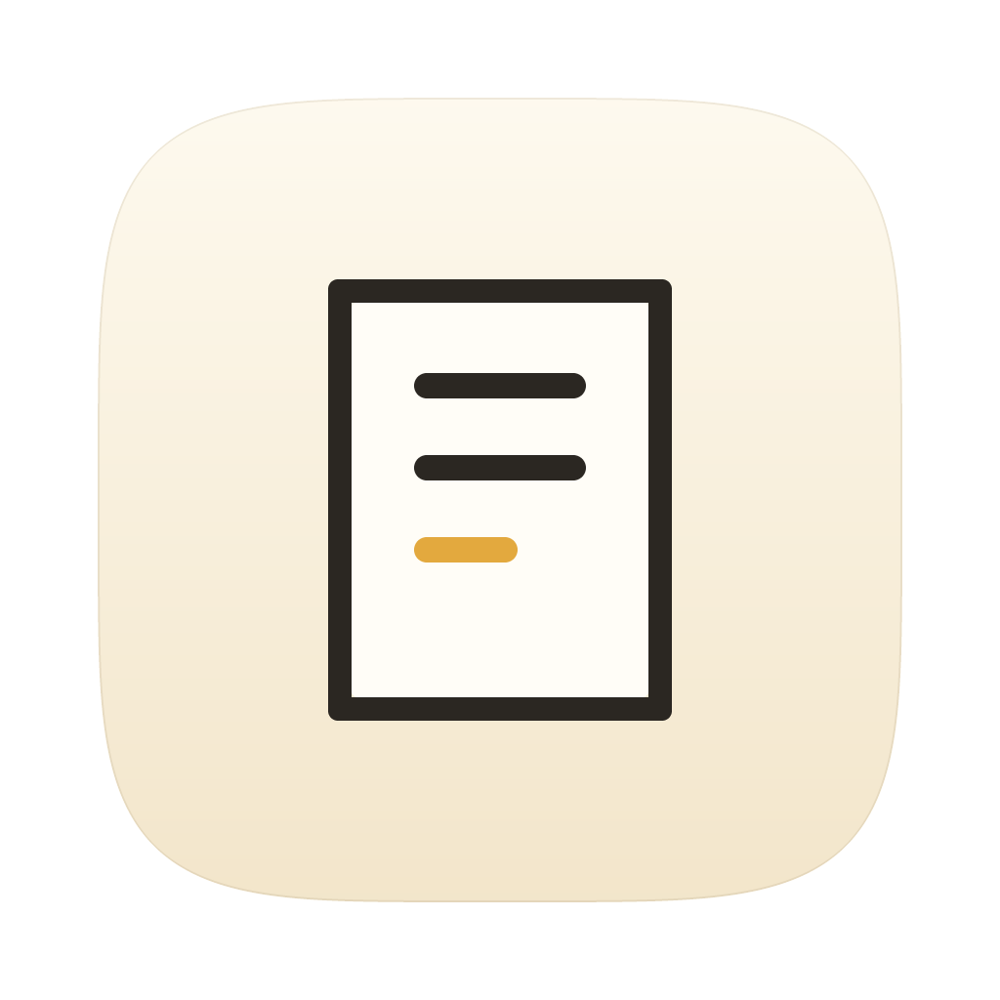

# Mote



一个只使用 [MyGo](https://mygo.egoist.dev/docs) 原生组件实现的 macOS 菜单栏工具：随手写 Markdown，也随手开始一段专注计时。极简记事本和番茄钟小工具。内容和计时记录都保存在本机 SQLite。

> 为什么不用系统记事本和闹钟？
> 因为够顺手，token用不完。ʕ•ᴥ•ʔ

## 安装

从 [Releases](https://github.com/xinde/Mote/releases) 下载最新的磁盘映像，把 **Mote** 拖入“应用程序”。

应用使用自签名（ad-hoc）构建，未经过 Apple 公证，所以首次启动需要右键点击图标选择“打开”，或执行：

```sh
xattr -dr com.apple.quarantine /Applications/Mote.app
```

启动后没有 Dock 图标，请点击菜单栏的便签图标，或按 `⇧⌘M`。

## 功能

### Markdown 记录

- 菜单栏常驻，点击图标打开或收起原生面板
- `⇧⌘M` 在任意 App 中呼出 Mote
- 停止输入 700ms 后自动保存，`⌘S` 可立即保存
- `编辑 / 预览` 使用 MyGo 原生 `TextArea` 与 `ui/markdown`
- 多条 Markdown 记录保存在 SQLite，可从“最近记录”切换
- 标题自动取 Markdown 第一行，完整源码原样保存
- 底部状态显示保存结果，点击状态可复制完整数据库路径，悬停显示路径
- 状态后的信息图标悬停显示快捷键
- `删除` 按钮删除当前记录，删除前会二次确认，确认框默认取消
- `钉住` 让窗口保持最前，切到别的 App 也不收起，编辑与自动保存照常

### 极简番茄钟

- 顶层“记录 / 专注”切换，计时器不挤占编辑器空间
- 默认 25 分钟专注、5 分钟休息
- 空闲时可将专注设为 1 至 120 分钟，休息设为 1 至 60 分钟
- 支持开始、暂停、继续与重置
- 运行时菜单栏显示固定宽度的等宽倒计时图像，数字变化不会造成抖动
- 收起窗口后仍以绝对截止时间计时，系统休眠不会造成累计漂移
- 完成后播放轻声双音并发送系统通知
- SQLite 只记录完成阶段、时长和时间，界面只显示今天完成的专注次数
- 应用重启后恢复运行中或暂停中的计时状态

## 开发运行

需要 Go 1.27.1 或更高版本。

```sh
go tool mygo dev
```

MyGo CLI v0.5.5 已通过 `go.mod` 的 `tool` 指令固定。开发 App 启动后不会显示 Dock 图标，请在 macOS 菜单栏找到便签形图标并点击。

首次开发运行时，MyGo SQLite 插件可能下载与平台匹配的原生 SQLite 动态库。打包后该库会随 App 一起分发，运行时不需要网络。

系统通知在首次计时完成时可能请求授权。即使拒绝通知，计时、提示音和 SQLite 记录仍可继续工作。

## 构建

```sh
go tool mygo build -skip-dmg          # 本机架构
go tool mygo build -platform darwin/universal   # Apple 芯片 + Intel
```

构建产物位于 `build/<平台>/`。生成的 `.app` 可以使用，但只有自签名。

应用图标由 `icon/gen.go` 生成，输出到 `resources/icon.png`：

```sh
go run icon/gen.go -o resources/icon.png
```

## 自动发布

`.github/workflows/release.yml` 在推送 `v*` 标签时工作：先校验标签与 `mygo.json` 的 `version` 一致，再构建 macOS 通用包，最后创建 GitHub Release 并附上磁盘映像。标签与版本不一致时不会发布。

```sh
# 先改 mygo.json 与 main.go 里的版本，再打标签
git tag v0.4.0
git push origin v0.4.0
```

`.github/workflows/ci.yml` 在推送到 `main` 和每个 PR 上运行测试、`go vet`、MyGo 的 UI vet 和构建。

当前流程没有 Apple Developer ID 证书，因此产物未签名、未公证。若日后要正式分发，在 `mygo.json` 中配置 `macos.signingIdentity` 与 `macos.notarize`，并在仓库 Secrets 中加入证书与公证凭据。

## 数据与隐私

- 数据库位于 `~/Library/Application Support/Mote/notes.db`。
- 首次启动 Mote 时，如果旧路径存在数据库而新路径还没有，会自动迁移旧数据。
- `notes` 保存 Markdown 源码，`app_state` 保存当前记录和计时状态，`focus_sessions` 保存已完成的计时阶段。
- 应用不读取或修改系统 Notes.app 数据。
- 应用不上传 Markdown 或计时数据。

## 快捷键

| 操作 | 快捷键 |
| --- | --- |
| 全局呼出 / 收起 | `⇧⌘M` |
| 立即保存 Markdown | `⌘S` |
| 新建记录 | `⌘N`（托盘右键菜单） |
| 收起弹窗 | `Esc` 或 `⌘W` |
| 退出 | `⌘Q` |
